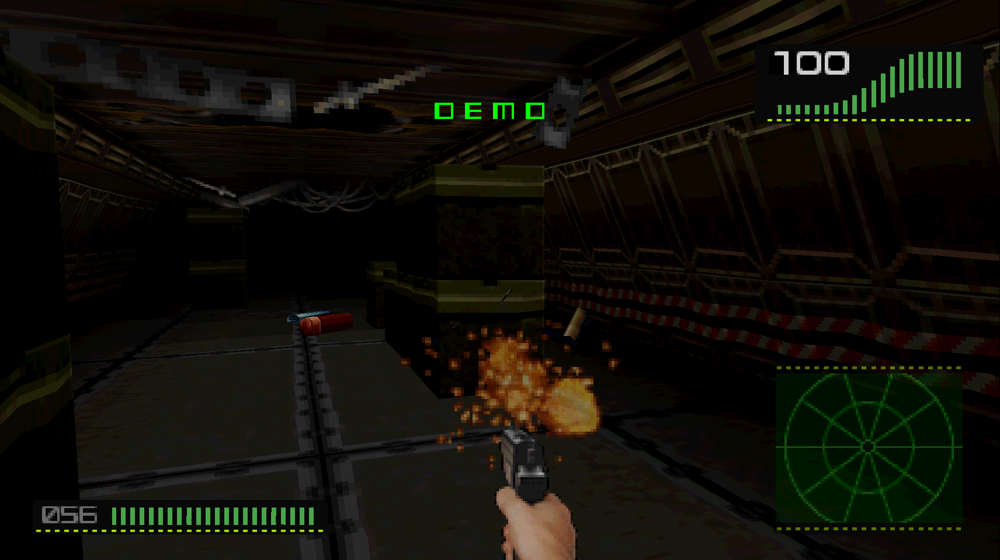
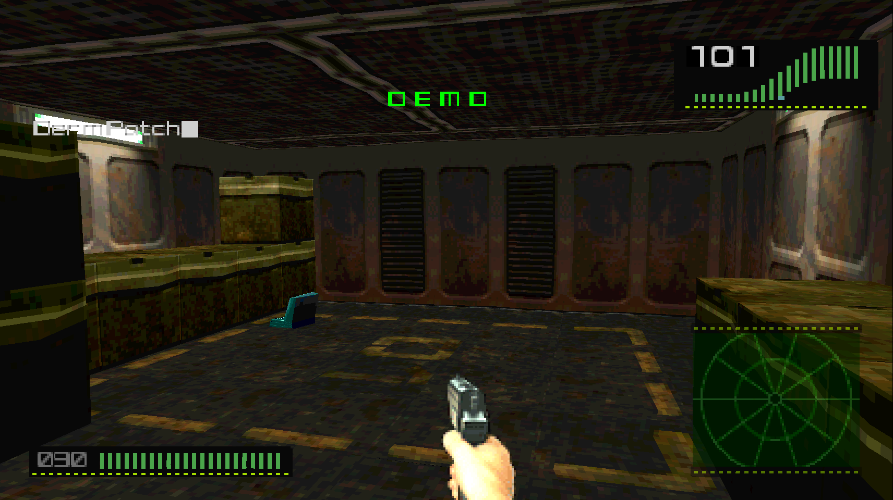
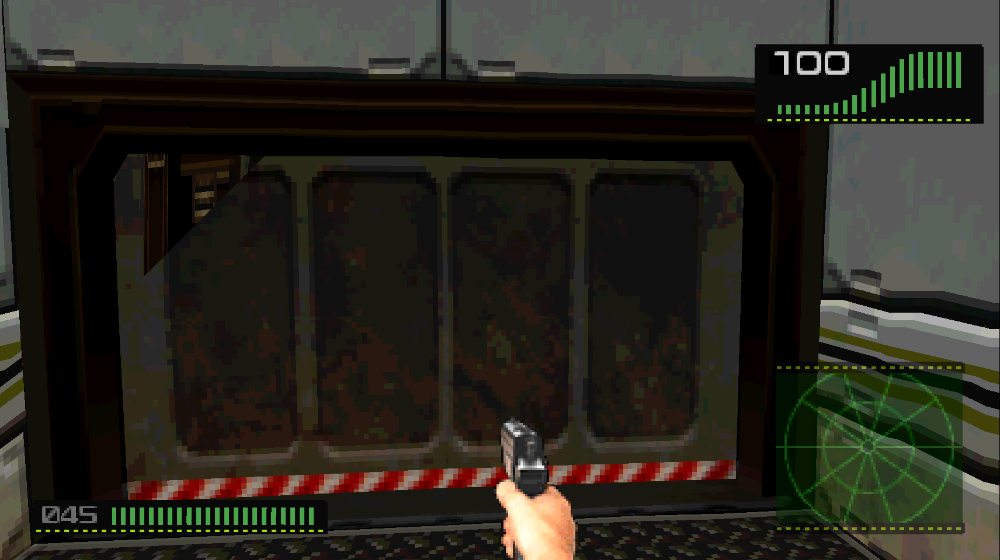
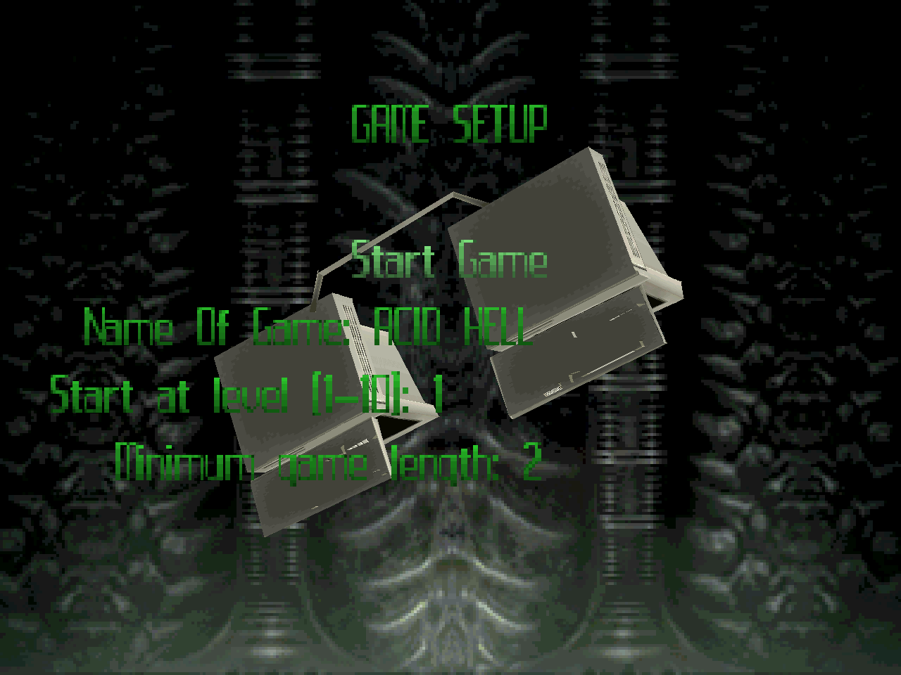
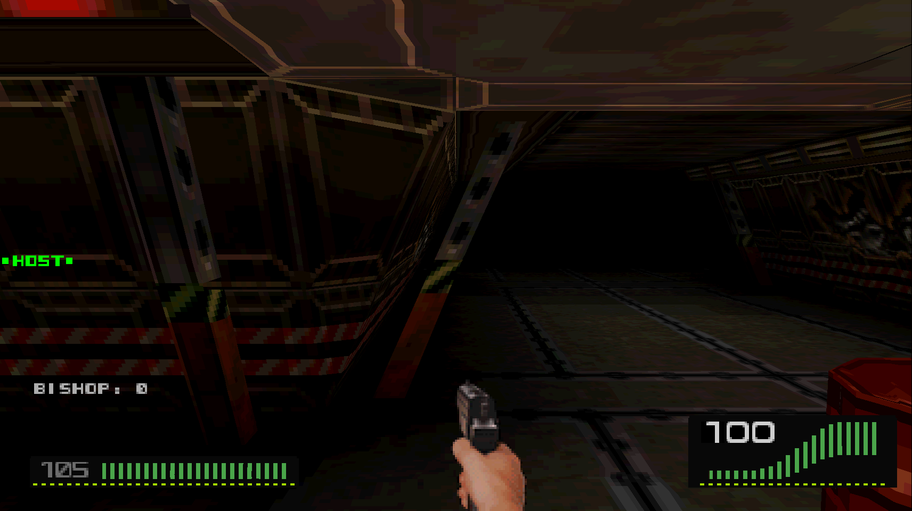
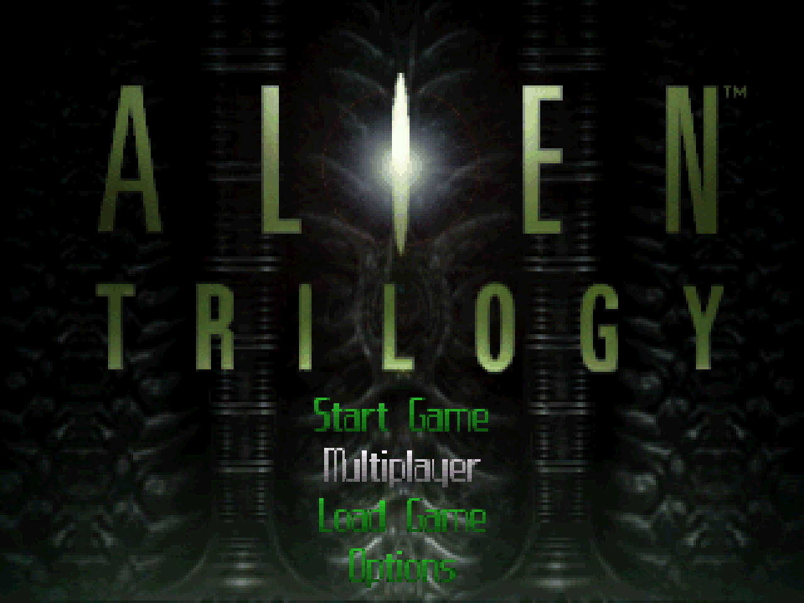

# Alien Trilogy - PC Native

The 1996 DOS CD version of Alien Trilogy (Probe / Acclaim) as a native Windows game: the game's own
x86 code converted to C by a static recompiler, running on a PC runtime that replaces DOS, DOS/4GW,
VESA, the Sound Blaster (Miles AIL), MSCDEX and CD audio. No emulator, no DOSBox.

| | |
|---|---|
|  |  |
|  |  |
|  | |

You need your own copy: the Alien Trilogy PC CD (EU version - disc, CCD/IMG, ISO, BIN/CUE or NRG) and
the official European patch 2.0b (ATUPDEU1, from the "Fixes" download; zip, folder or T16P.SHR).

## Install
Run `Alien Trilogy PC Setup.exe`, pick the CD and the patch, install. Silent:
`setup.exe /silent /cd <image|drive|folder> /patch <zip|folder> /dir <folder> [/nodesktop] [/nostartmenu]`

## What is added (all switchable in the Video menu / trilogy_pc.ini)
- Internal Resolution 1x-6x (default 4x): the game's software PlayStation-style renderer draws the
  whole frame at N x - 3D, HUD and menus.
- Movies without the black lines between rows (`[game] MovieLines`), option to skip the start-up logos
  (`SkipIntro`).
- Correct game speed on modern PCs (fixed 34.5 Hz logic clock; `GameSpeed` percent).
- Upscale filters (xBR, ...), CD music from ripped tracks, keyboard + mouse; WASD layout (Input menu).
- Mouse options in the game's own Options panel: mouse on/off, speed (half to double), FREELOOK (mouse
  up/down looks like a modern FPS; the automatic tilt on stairs is off then).
- Multiplayer (deathmatch, up to 4 PCs) over UDP: on a LAN games are found by themselves; over the internet use Input > Multiplayer: join over the internet (the host forwards UDP port 17733).
  Tip: the easiest way to play over the internet is **Radmin VPN** (free): everyone joins the same Radmin network,
  then the others enter the host's Radmin IP (26.x.x.x) in Input > Multiplayer: join over the internet - no router setup.
- True widescreen (Video > Wide view): in play the 3D view fills a wide window or screen, HUD panels at the screen edges, gun in the middle; menus and the Options panel stay 4:3.
- Movement: the same speed in every direction (strafe and back were half speed); hold Shift to walk (Shift was run).

## Building
See the Dos tools kit README (`dosport.py`): `./build.sh gen` regenerates `src/gen` from
`gamedata/TRILOGY.EXE` (EU 2.0b, 16-bit colour, Pentium build), `make release` builds the setup.
Test switches: `AT_HIDDEN=1`, `AT_ARGS=-nomovies`, `AT_KEYS`, `AT_SHOT`, `AT_HRSCALE`, `AT_HRCMP` (see
src/game/hires.c).

## Playing online
- Same network (LAN): Multiplayer > Start Multiplayer Game on one PC, Join Multiplayer Game on the others -
  the game is found by itself.
- Over the internet, easiest: **Radmin VPN** (free). Everyone installs it and joins the same Radmin network;
  the host starts the game, the others put the host's Radmin IP (26.x.x.x) in
  Input > Multiplayer: join over the internet, then Join Multiplayer Game. No router setup.
- Without a VPN the host forwards UDP port 17733 in the router and gives the others their public IP.
- Set your name in Multiplayer Options (everyone is "Bishop" by default). Allow the game in the Windows
  firewall prompt.
